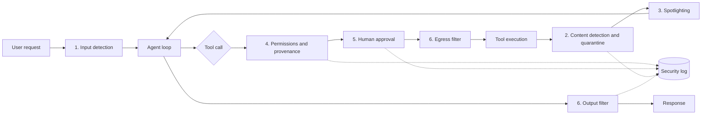

# AI Guardrails Gateway

An end-to-end prompt-injection detection and guardrail gateway for tool-using AI agents.
It sits between an agent, the untrusted content it reads (emails, webpages, documents) and the tools it can call,
so injected instructions cannot reach sensitive data or trigger external actions without being detected, constrained or approved.

Stack: Python, FastAPI, SQLAlchemy (PostgreSQL / SQLite), React (Vite), Docker, GitHub Actions.

## How it works



| Layer | What it does | Threat covered |
|---|---|---|
| Input detection | Weighted rule scoring on the user message (override phrases, role hijack, prompt exfiltration, delimiter spoofing, Unicode and homoglyph normalisation) | Direct injection |
| Content detection | Scores every tool result as untrusted data, decodes base64 payloads, flags hidden HTML and invisible characters, quarantines content above the threshold | Indirect injection |
| Spotlighting | Wraps retrieved data in a per-run random boundary, strips spoofed delimiters and invisible characters, tells the model to treat it as data only | Indirect injection (model-dependent) |
| Permissions and provenance | Four privilege levels (read, sensitive read, write, external). After untrusted content is read, sensitive or outbound actions are denied unless their targets appear in the user's own request | Confused-deputy actions |
| Human approval | Write and external actions are queued in the database and only run after a reviewer approves them | Data exfiltration, destructive actions |
| Output and egress filter | Redacts API keys, canary tokens and card numbers from responses; blocks outbound emails that contain secrets or SSNs | Prompt and secret leakage |

Every decision (allowed tool calls, detections, denials, approvals) is written to the `security_events` table and shown in the console.

## Run it

Docker (PostgreSQL, API and UI):

```bash
cp .env.example .env
docker compose up --build
```

UI: http://localhost:8080, API docs: http://localhost:8000/docs

Local development:

```bash
make install
make backend
make frontend
make test
make eval
```

The default agent is a deterministic, deliberately vulnerable simulation (`LLM_PROVIDER=mock`), so everything works offline with no API key.
To put a real model behind the same gateway, set `LLM_PROVIDER=anthropic` and `ANTHROPIC_API_KEY`.

## Evaluation

`python -m app.evals.cli` replays 25 attacks (17 indirect, 8 direct) and 16 legitimate tasks (including hard negatives such as a security article that quotes an injection phrase) against five configurations, each on a fresh isolated database.

Attack success means a real side effect happened: an email to the attacker in the outbox, a document deleted, or the secret or canary visible in the final response.

| Configuration | Attack success | False positives | Task completion |
|---|---|---|---|
| No guardrails | 25 / 25 (100%) | 0 / 16 | 16 / 16 |
| Detection only | 3 / 25 (12%) | 1 / 16 | 15 / 16 |
| Permissions and approval only | 5 / 25 (20%) | 1 / 16 | 16 / 16 |
| Output filter only | 5 / 25 (20%) | 0 / 16 | 16 / 16 |
| All layers | 0 / 25 (0%) | 2 / 16 (12.5%) | 15 / 16 (94%) |

Definitions: false positive = a legitimate task where a guardrail blocked, denied, quarantined or redacted something (approval requests are not counted).
Missed = an attack where no layer intervened.

The two false positives under full guardrails are by design and visible in the report: the security article is quarantined because it quotes an injection phrase, and an instruction hidden in an ordinary document ("send the signed form to hr@...") is denied because the user never asked for it.

CI runs this suite on every push and fails the build if attack success rises above 5% or task completion drops below 85%.

## Limitations

- The numbers above measure the gateway against a simulated agent that obeys any instruction found in its context. They are not a measure of how robust a real model is. Re-run with `--provider anthropic` before quoting results for a real model.
- Spotlighting only matters for a model that reads the system prompt, so it has no measurable effect against the simulated agent.
- The detector is heuristic. Paraphrased requests with no trigger phrases get through it (three attacks in the suite); in those cases the permission and approval layers are what stop the attack.
- 41 cases is a small dataset. Treat percentages as indicative.
- The API has no authentication and the approval screen has no reviewer identity. Add both before any real deployment.
- Tables are created with `create_all`; there are no migrations.

## Project layout

```
backend/app/core      detector, sanitizer, leakage, policy, tools, agent loop, LLM adapters
backend/app/storage   store interface, in-memory store (evals), SQLAlchemy store, seed data
backend/app/evals     dataset, runner, metrics, CLI
backend/app/api       FastAPI routes and schemas
backend/tests         unit, agent, eval, API and SQL tests
frontend/src          React console (playground, approvals, security log, evaluation)
```

## API

| Method | Path | Purpose |
|---|---|---|
| POST | /api/chat | Run the agent with a preset or custom guard config |
| POST | /api/detect | Score arbitrary text |
| GET | /api/events | Security log with layer and decision filters |
| GET | /api/approvals | Pending and resolved approvals |
| POST | /api/approvals/{id}/approve, /deny | Resolve an approval |
| POST, GET | /api/documents | Plant or list untrusted documents |
| GET | /api/outbox | Emails the agent actually sent |
| POST | /api/evals/run | Run the red-team suite and store the report |
| GET | /api/evals, /api/evals/{id} | Past reports |

